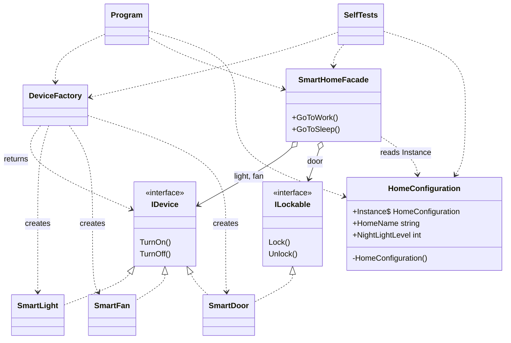

# Smart Home Mini — Bài thực hành 10

Phan Thị Hải Yến — MSSV **202419124**.

Mã nguồn: https://github.com/yenpth265-alt/Smart-Home-Mini

Ứng dụng C#/.NET 8 chạy terminal, mô phỏng đèn, quạt và cửa; không kết nối thiết bị thật.

## Chạy chương trình

Cài .NET SDK 8 hoặc mới hơn, mở terminal tại thư mục dự án:

```sh
dotnet run
dotnet run -- --demo
dotnet run -- --test
```

Menu hỗ trợ đi làm, đi ngủ, tạo thiết bị theo loại, điều khiển riêng và đặt mức sáng đêm 0–100. Ba thiết bị đầu tiên được dùng trong các chế độ; thiết bị thêm được điều khiển riêng theo số thứ tự. EOF hoặc 0 kết thúc chương trình.

## Thiết kế

- `src/Devices.cs`: IDevice, ILockable, SmartLight, SmartFan, SmartDoor. Khóa cửa độc lập với nguồn của bộ điều khiển.
- `src/Patterns.cs`: DeviceFactory (Simple Factory), HomeConfiguration (Singleton), SmartHomeFacade (Facade).
- `src/Program.cs`: client terminal, tạo thiết bị qua factory và gọi facade.
- `src/SelfTests.cs`: kiểm thử tự động, mã thoát 1 nếu thất bại.



## Pattern và câu hỏi phân tích

1. Factory che giấu quyết định chọn lớp cụ thể và cách gọi constructor từ chuỗi loại thiết bị. Factory trả IDevice, chuẩn hóa khoảng trắng/hoa thường và ném ArgumentException khi loại không hỗ trợ. Đây là Simple Factory, không phải cấu trúc Factory Method dựa trên kế thừa. Thêm SmartCamera cần tạo lớp triển khai IDevice, thêm nhánh factory và kiểm thử; client điều khiển chung không cần gọi constructor mới.
2. Singleton bảo đảm một thể hiện cấu hình trong tiến trình. Constructor private ngăn tạo bên ngoài; sealed ngăn kế thừa. Lazy<T> bảo vệ khởi tạo nhưng không tự làm mọi thao tác cập nhật cấu hình an toàn luồng. Trạng thái toàn cục dễ khiến test ảnh hưởng lẫn nhau; test đổi mức sáng phải phục hồi trong finally. Nếu có .NET DI với AddSingleton thì thường không cần tự cài Singleton; có thể tiêm cấu hình để kiểm thử thuận tiện hơn.
3. Factory phục vụ tạo đối tượng; Facade cung cấp thao tác mức cao điều phối các đối tượng đã có. GoToWork tắt đèn, tắt quạt, khóa cửa. GoToSleep tắt quạt, khóa cửa, bật đèn và thông báo mức sáng lấy từ cấu hình chung.
4. Nếu bỏ facade, client phải biết thứ tự thao tác, interface khóa, thiết bị nào cần điều khiển và cách đọc cấu hình ban đêm. Facade giữ IDevice cho đèn/quạt và ILockable cho cửa, giúp giảm phụ thuộc vào lớp cụ thể.

Cấu hình chung gồm tên nhà và mức sáng ban đêm; trạng thái bật/tắt, khóa/mở thuộc từng thiết bị. Lợi ích: tách trách nhiệm tạo, chia sẻ cấu hình và điều phối. Hạn chế: factory phải sửa khi thêm loại; facade đang cố định bộ ba thiết bị; Singleton làm tăng phụ thuộc toàn cục. Mức sáng chỉ được mô phỏng bằng thông báo theo đề, không điều khiển phần cứng.

## Kết quả kiểm thử

`docs/test-results.txt`: kết quả thực chạy T1–T8. T1 đúng ba kiểu; T2 từ chối camera; T3 cùng tham chiếu; T4 trạng thái đi làm; T5 trạng thái đi ngủ và xuất mức sáng 47%; T6 chuẩn hóa loại; T7 đầu vào lỗi; T8 trạng thái cửa. `docs/demo-output.txt`: kết quả chạy kịch bản minh họa.

Báo cáo nộp: `docs/Bao-cao-Smart-Home-Mini.pdf`, gồm liên kết GitHub, danh sách lớp/interface, sơ đồ quan hệ và kết quả thực chạy.
